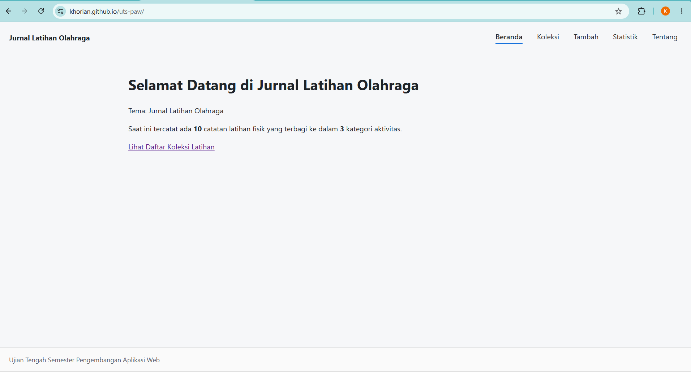

# Ujian Tengah Semester - Pengembangan Aplikasi Web

- **Nama:** Khorian Mukhsin
- **NIM:** 123140006
- **Kelas:** RA
- **Tema:** Jurnal Latihan Olahraga
- **URL Deployment:** https://khorian.github.io/uts-paw/

## Fitur Aplikasi
- Menampilkan daftar koleksi jurnal latihan olahraga dari data awal (`koleksi.json`) dan `localStorage`.
- Pencarian berdasarkan judul latihan (`<input type="search">`).
- Filter berdasarkan kategori latihan.
- Detail item lengkap dengan field tanggal, durasi, dan kalori terbakar.
- Form tambah data dengan validasi kustom dan atribut `role="alert"`.
- Tabel statistik kategori latihan dan total keseluruhan.
- Halaman tentang dan penanganan rute 404.

## Cara Menjalankan
1. Masuk ke folder `app/`: `cd app`
2. Install dependensi: `npm install`
3. Jalankan mode development: `npm run dev`
4. Jalankan build: `npm run build`

## Tangkapan Layar
